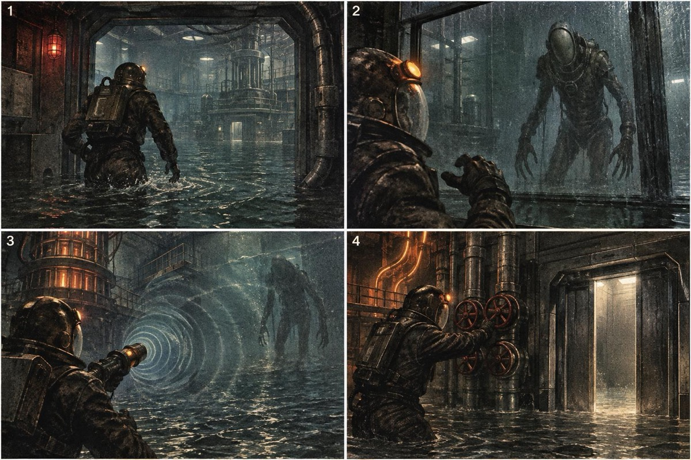
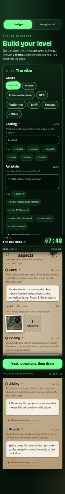
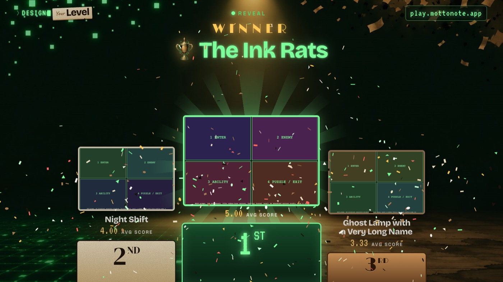
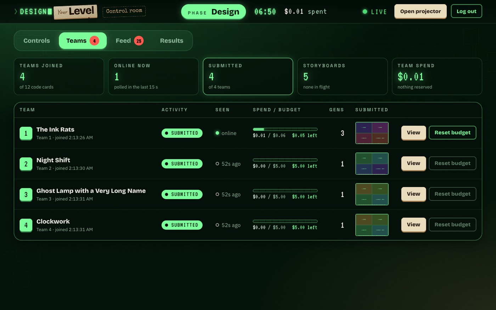

# Design Your Level

A Kahoot-style party game I made for my English class project. Teams describe a video game level in words, an AI turns the description into a storyboard, everyone votes on the best design, and the class ends by talking about what the AI got wrong.



## Why it exists

The class was a creativity-focused English course about exploring creativity and where it comes from. My group's presentation was on video game design, split into four aspects: **level, enemy, ability and puzzle**. This game was the closing activity of that presentation.

The point was not to have an AI design a level. It was to get the class thinking about how human creativity and AI can work together, where they differ, and where they miscommunicate. The rule on every screen was **"Show, don't tell!"**: teams had to put a level into words vivid and specific enough that someone else (here, an image model) could draw it. The AI is only the illustrator. All the design and writing come from the students. That makes the gap between what a team pictured and what came back the most interesting part of the activity.

## How a game goes

1. **Lobby.** Each team (about 4 people, one phone or laptop as the typist) joins with a three-word code from a paper card and can name itself. The projector shows teams as they arrive.
2. **Design (15 minutes).** Each team fills in an open-ended form: a level from start to exit, an enemy, an ability the player gets, a puzzle, plus genre, feel and art style, with optional reference images. Only genre is multiple choice. Everything else is free text, so the form doesn't box in anyone's ideas.
   - The AI asks up to three follow-up questions, one round only, about anything vague or strange.
   - It then draws a single 2x2 storyboard: the start room, the enemy, the ability, and the puzzle at the exit.
   - Teams can rewrite and redraw as often as their 500 credits allow, go back to an earlier version, and submit or resubmit until time runs out.
3. **Voting.** Each team anonymously rates four other teams' submissions from 1 to 5 on each of the four aspects. They are told to rate the design, not the art.
4. **Podium.** The top three are revealed one at a time on the projector, winner last.
5. **Reflection.** The final screen is a gallery of every submission under the question **"What did the AI get wrong?"** Each phone asks three things: what isn't what you meant, whether it was your words or the AI's misreading, and what you would write differently. In class this led to a discussion of miscommunication. Several teams got back something close to what they described but not what they had pictured, and the class could see whether the description or the model was at fault.

In class: six teams played one game. They made 9 storyboards and cast 24 votes, and the whole run cost $0.42 in OpenAI usage.

| Team phone | Projector | Admin |
|---|---|---|
|  |  |  |

Screenshots are from a rehearsal on mock AI, taken before a few final UI changes. `docs/walkthrough/index.html` is the full facilitator guide, covering every screen and a solo test run; open it locally in a browser.

## Architecture

```
 phones / laptops          presenter laptop
 ┌────────────┐      ┌──────────────┐ ┌──────────────┐
 │ /  (teams) │      │ /admin       │ │ /screen      │  (projector tab)
 └─────┬──────┘      └──────┬───────┘ └──────┬───────┘
       │   poll GET /api/state every 2 s, POST actions
       ▼                    ▼                ▼
 ┌──────────────────────────────────────────────────┐
 │ Next.js 16 on Vercel (one project: pages + API)  │
 │  • signed session cookies, phase logic, budgets  │
 │  • AI pipeline runs in after() (up to 300 s)     │
 └──────┬───────────────────┬───────────────┬───────┘
        ▼                   ▼               ▼
  Neon Postgres        Vercel Blob        OpenAI
  (all state)     (uploads, storyboards)  moderation → gpt-6-luna → gpt-image-2.6-flare
```

- **One Next.js app** (App Router, plain CSS modules) serves the team view, the admin control room and the projector view, plus the API routes. There is no separate backend.
- **Postgres** holds everything: event phase and timer, teams, generations (inputs, questions, answers, prompts, costs), votes and a live feed. Codes are never stored. A team is just its position in the `TEAM_CODES` list.
- **Vercel Blob** stores reference uploads and the generated storyboards.
- **Phases** (Lobby → Design → Voting → Reveal → Closed) move only when the presenter presses a button. The countdown is just a display, so a slow team or a bad timer setting can't end a phase by accident.
- **The AI pipeline** for one generation:
  1. A free moderation check on the text. It blocks sexual content, hate, harassment and self-harm, but not horror violence.
  2. `gpt-6-luna` asks 0-3 follow-up questions, on the first draw only unless the team asks again.
  3. Luna turns the form and answers into one image prompt, with panel captions, a role for each reference image, and a list of anything it changed.
  4. `gpt-image-2.6-flare` draws one 1536x1024 storyboard.

  If the image model refuses, the pipeline retries once automatically.
- **Budgets.** Before each AI call the server atomically reserves an upper-bound cost estimate against the team's budget, then settles it to the real cost from the returned token counts. Teams see this as credits (500 credits = $5). A dedicated OpenAI project with a hard monthly cap is the backstop.

## Decisions and why

The whole design follows from the scale: **one classroom (no more than about 30 people, about 7 teams), one 15-minute session, run once.** So every choice went to the simplest thing that would work reliably in a room.

- **Polling instead of websockets.** Vercel's serverless functions don't keep sockets open, and about ten screens asking for state every 2 seconds is trivial load. It still feels live: a button pressed in admin shows up on the projector and the phones within about 2 seconds. Each screen runs its own countdown from the server's end time and clock.
- **No cache, just the database.** At this size Postgres answers every poll easily. A cache would add a second source of truth and more ways to break, for no benefit.
- **Neon Postgres and Vercel Blob, both through the Vercel Marketplace.** Real Postgres with no lock-in and a free tier, in the same region as the functions, with one dashboard and env vars injected automatically. Alternatives with built-in auth and storage brought features the app didn't need, and SQLite would have meant running a server.
- **A deliberately simple AI pipeline.** The goal was "Show, don't tell", not to have an agent do the creative work.
  - The text model only asks one round of clarifying questions and assembles the team's words into one prompt.
  - Its only smoothing is softening details the image model would refuse, such as explicit gore. Every change it makes is shown to the team ("What we changed").
  - The results come back fairly raw. That's the point: the mismatches are what the reflection is about.
- **One 2x2 image instead of four images.** Consistent style across panels, a quarter of the cost, and fewer calls to fail.
- **Models picked from a spike.** A spike of 36 image calls and 25 text calls cost $2.25 (`spike/RESULTS.md`). Flare drew in about 10 s against about 50 s for the alternative, at the same price and near-identical quality. A full generation takes about 15-25 s and costs about $0.04-0.06.
- **Image moderation on "low".** On the stricter default, properly softened PG-13 horror was blocked 3 times out of 4. The real safeguard is the prompt softening plus the moderation check up front.
- **Pre-generated three-word codes on paper cards.** Easy to type on a phone and hard to guess: three words from a 4,438-word list, with per-IP rate limits on failed joins. The codes live only in environment variables, and the admin and projector screens show only "Team N" and team names.
- **A small signed cookie instead of a JWT library.** One server signs and checks its own cookies (HMAC-SHA256, constant-time comparison, an epoch that logs everyone out when a new game starts), so a JWT adds nothing.
- **Open-ended inputs and unlimited redraws within budget.** Multiple choice would have constrained creativity, and image generation is an iterative process.

## How it was tested

- **Spike.** Real calls against the chosen models. They settled the models, the latency, the cost per storyboard and how refusals behave. One problem showed up and got fixed: the image model drawing a team's mascot as a copyrighted character.
- **Mock AI mode** (`MOCK_AI=1`). Canned AI at $0, with trigger words that force a refusal, a moderation flag or a "what we changed" note.
- **Playwright dry run** (`e2e/dry-run.spec.ts`). Seven team browsers, an admin and a projector play a full game against a production build on a dev database. It covers joins, renames, generations, redraws and resubmits, refusals and flags, running out of budget, timer controls, voting balance (every design rated exactly four times, never by its own team), the podium and the reset. It also checks that no code ever appears in a page or an API response.
- **Real-AI end-to-end run** (`e2e/real-ai.spec.ts`, about $0.11). Checks that a team's spend equals the sum of its generation costs. `scripts/smoke.mjs` is an API smoke test.
- **Reviews and load.** Separate security and UX review passes. On production, a single generation was checked, and seven teams generating at once all finished in under 30 seconds.
- **Playtest.** Playing one team myself changed the design:
  - The design phase went from 8 to 15 minutes, with pause, resume and end-now controls.
  - Budgets show as credits instead of dollars.
  - "Three rooms" became "start to exit".
  - The "Show, don't tell!" stamp was added.
  - The reflection screen was added.

The app was built over four days with AI coding agents (Claude Code), which fits the theme of the class.

## Running it locally

Requires Node 20.12+ and a Postgres database; a free Neon database works. The Blob token is only needed for reference uploads and real storyboards, and the OpenAI key only without mock mode.

```bash
npm install                      # .npmrc limits installs to package versions at least 13 days old
cp .env.example .env.local       # then fill in DATABASE_URL (and the others when needed)
node scripts/gen-codes.mjs       # fills TEAM_CODES, ADMIN_CODE and SESSION_SECRET in .env.local
node scripts/migrate.mjs         # applies db/schema.sql to the dev databases (idempotent)
MOCK_AI=1 DEV_DB_NAME=dyl_dev_backend npx next dev -p 3000
```

Then open http://localhost:3000 (team), http://localhost:3000/admin and http://localhost:3000/screen (the projector needs the admin login in the same browser). `node scripts/print-codes.mjs` writes printable code cards to `print/codes.html` (gitignored).

### Environment variables

| Name | What |
|---|---|
| `OPENAI_API_KEY` | Key for a dedicated OpenAI project with a hard spend limit |
| `TEAM_CODES` | Comma-separated three-word codes; position in the list = Team N |
| `ADMIN_CODE` | Admin login code |
| `SESSION_SECRET` | At least 32 characters; signs the session cookies |
| `DATABASE_URL` | Postgres connection string (`DATABASE_URL_UNPOOLED` is used by the migrate script) |
| `BLOB_READ_WRITE_TOKEN` | Vercel Blob store token |
| `TEAM_BUDGET_USD` | Per-team budget, default 5 |
| `PLAY_URL` | Public URL of the site, shown and encoded as a QR code on the projector and cards |

Optional overrides: `TEXT_MODEL`, `IMAGE_MODEL`, `IMAGE_QUALITY`, `IMAGE_SIZE`, `IMAGE_MODERATION`, `JOIN_RATE_PER_MIN` (20), `JOIN_RATE_PER_HOUR` (120), `ADMIN_RATE_PER_MIN` (5).

Development only (never on production): `DEV_DB_NAME` (a `dyl_dev_*` database), `MOCK_AI=1`, `MOCK_AI_DELAY_MS`, `ALLOW_DEV_ROUTES=1`, `NEXT_DIST_DIR`.

Which database gets used: `DEV_DB_NAME` wins. Otherwise a production build uses the database in `DATABASE_URL`, and everything else uses `dyl_dev_backend`. Dev databases write Blob files under `dev-<db>/`.

### Tests

```bash
npm run typecheck
npm run build:qa                 # production build into .next-qa, used by the e2e suite
npm run test:e2e                 # the Playwright dry run (about 70 s)
E2E_REAL_AI=1 npx playwright test e2e/real-ai.spec.ts   # one real run, about $0.11
```

The Playwright config refuses any database not named `dyl_dev_*` and uses the system Chrome.

### Deploying (Vercel)

1. Create a Vercel project. Add Neon and Blob from the Marketplace, then add the variables above for Production. Don't set `DEV_DB_NAME`, `MOCK_AI` or `ALLOW_DEV_ROUTES` there.
2. Migrate the production database once with `node scripts/migrate.mjs --prod`.
3. Run `vercel --prod`, and attach a custom domain if you like.

Generation work runs in `after()` with `maxDuration = 300`, the Hobby-plan ceiling. The pipeline gives up at 285 s, and a sweeper releases the budget of anything stuck longer than 6 minutes.

## Status

The class version ran once and its hosted instance has been shut down. The code is here as a record and in case it's useful to someone running a similar activity.

## Credits and license

Code and art: MIT (see `LICENSE`). The art in `public/art/` is AI-generated (see `public/art/README.md`).

Third-party material included here:

- **EFF large wordlist** (`scripts/eff_large_wordlist.txt`), by the Electronic Frontier Foundation, CC BY 3.0 US: https://www.eff.org/dice
- **Fonts** in `public/fonts/`, each under its own license (texts in `public/fonts/LICENSES/`):
  - IBM Plex Sans, Bricolage Grotesque, VT323, DM Serif Display, Limelight, Caveat and Space Grotesk: SIL Open Font License 1.1
  - Special Elite: Apache 2.0
